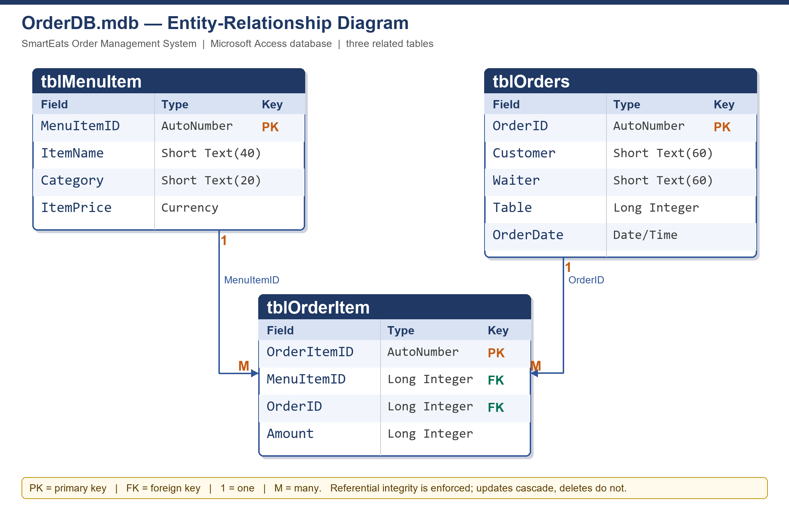
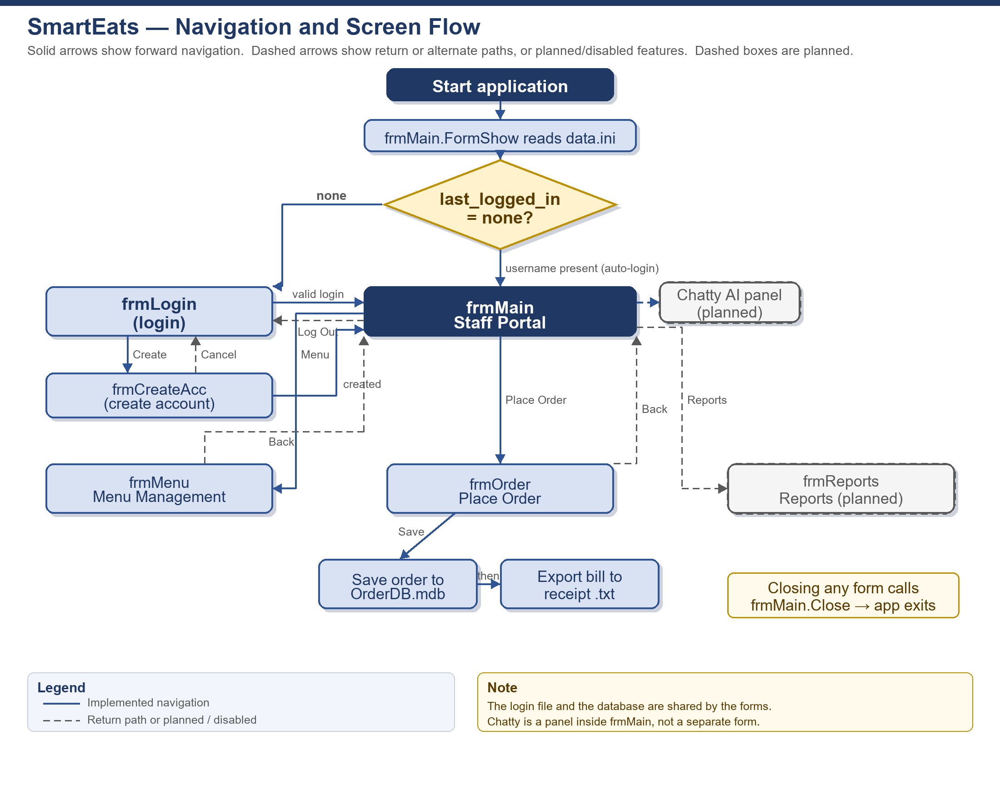

# SmartEats Order Management System

## Grade 11 Information Technology — Practical Assessment Task 2026

### Phase 1: Tasks 1–5 — Requirements Analysis and Design

**Learner:** Ewan Connan

**Grade:** 11

**Subject:** Information Technology

**Year:** 2026

**Document version:** 1.0

**Date:** 18 October 2026

> This document completes Phase 1 of the Grade 11 Information Technology Practical Assessment Task (PAT) for 2026. It describes the current SmartEats build and identifies features that are still planned. Planned or disabled features are clearly marked so that the documentation does not claim that they already work.

## Contents

1. Project overview and research (Task 0)
2. Task 1A: Define the task
3. Task 1B: User stories and acceptance tests
4. Task 2: Data dictionary
5. Task 3: Database design
6. Task 4: Navigation and flow between screens
7. Task 5: IPO tables and data validation
8. Requirements traceability
9. Known limitations and planned improvements
10. References
11. Appendix A: Learner declaration — Tasks 1–5

## 1. Project overview and research (Task 0)

### 1.1 Background

SmartEats is a restaurant franchise that offers both dine-in and online orders. At present, the restaurant uses paper-based records for its menu, customer orders, payments and reservations. Paper records are slow to search, easy to lose and difficult to total accurately. When several waiters take orders at the same time, handwriting can be misread, prices can be copied incorrectly and orders can be misplaced. The result is a slower service, incorrect bills and unhappy customers.

The PAT topic requires a single Delphi application that automates one aspect of SmartEats' operations. This project automates the order-management process: maintaining the menu, capturing a customer's order, calculating the subtotal, VAT and total, saving the order in a database and exporting a formatted bill. A built-in AI assistant is included in the design to give short food recommendations.

### 1.2 Research into existing systems

Before designing the solution, several existing restaurant systems were studied. The aim was not to copy them, but to identify the features that make a restaurant ordering system efficient and to choose a realistic scope for a school project.

**Table 1: Summary of researched systems**

| System | Main strengths | Feature adopted in this project |
|---|---|---|
| Toast POS | Combines ordering, payments, kitchen tickets and sales reporting in one workflow. | Menu-driven order capture and a clear bill output. Payments are outside the scope. |
| Lavu | Shows how menu items, orders, inventory and staff management interact. | Separation of menu items from order lines, and a waiter field on each order. Inventory is not implemented. |
| SevenRooms | Manages reservations, table allocation and customer history. | Customer name and table number are stored on each order. Reservations are not implemented. |
| 7shifts | Demonstrates that restaurant systems also manage staff. | The waiter's name is recorded with each order. Scheduling is not implemented. |
| Sintel Systems POS | Demonstrates the standard workflow of choosing menu items, sending an order and producing a bill. | The core workflow of the Place Order screen. |

### 1.3 Purpose and scope of the proposed solution

The product is a desktop application written in Delphi FireMonkey (FMX) for 64-bit Windows. It is aimed at restaurant managers and waiters, not at customers using their own devices. The manager maintains the menu. The waiter captures orders at a table, sees the financial totals immediately, saves the order and exports the bill to a text file. The application is a single program with logically related forms and one local Microsoft Access database.

The scope is deliberately limited to the operations that can be completed and tested within the PAT. Features that are present in commercial systems but outside the scope of this project include online payments, stock control, supplier ordering, reservations, customer loyalty and staff scheduling.

## 2. Task 1A: Define the task

SmartEats currently records its menu, customer orders and payments on paper. This causes pricing errors, misplaced orders and delays, especially when several waiters place orders at the same time. Staff also need to see accurate prices and totals before an order is saved and billed. The restaurant therefore needs a single, reliable digital system that staff can use quickly during service.

The proposed solution is a Delphi FireMonkey desktop application for restaurant managers and waiters. The manager can add, view, update and delete menu items, while a waiter can select menu items, set quantities, capture the customer, waiter and table number, and see the subtotal, 15% VAT and total before saving the order. A saved order can be exported as a formatted text-file bill. The design also includes a built-in AI assistant that will give short food recommendations.

The scope is one Windows application with a Microsoft Access database containing three related tables, text files for secure login details and receipts, arrays for order lines, and reusable methods. Reports and order editing are planned. The program is limited to 64-bit Windows and a local database; it does not process payments, manage stock or handle bookings.

**Word count:** 195 words.

## 3. Task 1B: User stories and acceptance tests

### 3.1 User roles

Two direct user types were identified. A third stakeholder, the customer, benefits from the system but does not operate it.

**Table 2: User roles**

| User | Role and context | Main needs | Value gained |
|---|---|---|---|
| Manager | Responsible for the menu, prices and the accuracy of the restaurant's records. Works in the office or at the front of the restaurant. | Add, change and remove menu items quickly; be sure that changes are saved; keep the menu accurate. | Fewer pricing mistakes, an up-to-date menu and less time spent correcting paper records. |
| Waiter | Takes orders at the table during a busy service. Needs to work quickly and avoid mistakes. | Choose menu items, set quantities, see the running total, save the order and produce a correct bill. | Faster order capture, fewer lost or misread orders and a correct bill at the end of the meal. |
| Customer (indirect) | Does not use the program. Receives the food, the bill and, if the AI assistant is enabled, a recommendation from the waiter. | Correct order, correct bill and quick service. | A more accurate and faster dining experience. |

### 3.2 User stories

**Table 3: User stories for the two direct user types**

| ID | As a … | I want to … | So that … |
|---|---|---|---|
| US-01 | Manager | log in with a username and password | only authorised staff can change the menu |
| US-02 | Manager | add a new menu item with a name, category and price | the item can be ordered by waiters |
| US-03 | Manager | update the name, category or price of an existing menu item | the menu and its prices stay accurate |
| US-04 | Manager | delete a menu item that is no longer sold | waiters cannot order an item that is unavailable |
| US-05 | Manager | move to the first, previous, next or last menu record | I can find and edit an item quickly |
| US-06 | Waiter | create an order for a table by choosing menu items and quantities | the customer's order is recorded accurately |
| US-07 | Waiter | remove an incorrect order line and see the totals update immediately | the bill is correct before it is saved |
| US-08 | Waiter | save the order and export a formatted bill to a text file | the customer receives a record and the restaurant keeps a copy |

US-09 and US-10 are planned. The AI panel and the Reports form exist in the current build, but the AI service is not started and the report buttons contain no code. They are therefore listed separately in Table 4 and are not used as the basis for the acceptance tests that must pass in the current build.

**Table 4: Planned user stories**

| ID | User story | Current status |
|---|---|---|
| US-09 | As a waiter, I want to ask the AI assistant for a food recommendation so that I can answer a customer quickly. | The chat panel and streaming code exist. The local llama.cpp server and model are not started, so the feature is disabled. |
| US-10 | As a manager, I want to view daily sales, popular items and sales by category so that I can monitor performance. | The Reports form exists, but its buttons have no event handlers and the navigation button is hidden. |

### 3.3 Acceptance tests

An acceptance test describes an observable result that proves a user story has been satisfied. The tests below cover the working functions of the current build. Each test is written so that it can be executed during the PAT interview.

**Table 5: Acceptance tests**

| ID | Story | Test action or input | Expected result |
|---|---|---|---|
| AT-01 | US-01 | Enter a valid username and password on the Login form and click Enter. | The Staff Portal opens and `data.ini` stores the username as `last_logged_in`. |
| AT-02 | US-01 | Enter a valid username with an incorrect password. | The red message "Username or password is incorrect." appears, both fields are cleared and the Login form remains open. |
| AT-03 | US-01 | Change one character in a stored line of `login-details.txt`, then try to log in. | A critical-error message appears and the login is blocked. |
| AT-04 | US-02 | Enter a menu item name, choose a category, enter a price and click Add. | The new item appears in the menu grid and in the order-item combo box, the item count increases and a new row is stored in `tblMenuItem`. |
| AT-05 | US-03 | Select a menu row, change its price and click Update. | The grid shows the new price and the corresponding database row is updated. |
| AT-06 | US-04 | Select an unreferenced menu item and click Delete. | The item disappears from the grid and the order-item combo box, and its database row is deleted. |
| AT-07 | US-05 | Click the first, previous, next and last navigation buttons. | The selected row moves within the grid, the fields show the selected record and the selection stops at the first and last rows. |
| AT-08 | US-06 | Select a menu item, enter an amount of 2 and click Add to order. | A line appears in the order grid with the item name, unit price, quantity 2 and a line total equal to twice the unit price. |
| AT-09 | US-07 | Select an order line and click Remove line. | The line disappears from the grid and the subtotal, VAT and total are recalculated. |
| AT-10 | US-07 | Add a R100 item with quantity 1 and a R20 item with quantity 2. | The subtotal is R140.00, VAT is R21.00 and the total is R161.00. |
| AT-11 | US-08 | Enter a customer, waiter and table number for a valid order and click Save Order. | A new row is stored in `tblOrders`, the order lines are appended to `tblOrderItem` and the Export Bill button becomes enabled. |
| AT-12 | US-08 | After a successful save, click Export Bill to file. | A `receipt-yyyy-mm-dd-hh-nn-ss.txt` file is created in `data/receipts` containing the header, order lines, subtotal, VAT and total, and a confirmation message is shown. |

**Note:** AT-11 and AT-12 assume the explicit order-line `Post` described in Section 9. In the current build, the final line may remain pending until the dataset next moves.

## 4. Task 2: Data dictionary

### 4.1 Naming conventions

The project uses prefixes to make the purpose of a variable or component clear without reading the rest of the code.

**Table 6: Naming conventions used in the project**

| Prefix | Meaning | Examples |
|---|---|---|
| `s` | String | `sCurrentUser`, `sUsername`, `sFileHash` |
| `i` | Integer | `iIndex`, `iPos`, `iOrderID` |
| `b` | Boolean | `bCredentialsCorrect`, `bPassHasNum` |
| `d` | Double or currency value | `dSubtotal`, `dVat`, `dTotal` |
| `arr` | Array | `arrNewOrder`, `arrMenuIndexToID` |
| `t` | Text file variable | `tLoginDetails`, `tTextFile` |
| `frm` | Form instance | `frmMain`, `frmLogin` |
| `edt` | Edit box | `edtUsernameLogin`, `edtMenuPrice` |
| `btn` | Button | `btnLogin`, `btnOrderSave` |
| `lbl` | Label | `lblLoginError`, `lblOrderTotalValue` |
| `cmb` | Combo box | `cmbMenuCategory`, `cmbOrderItem` |
| `grd` | String grid | `grdMenu`, `grdOrderLines` |
| `mem` | Memo | `memAIInput`, `memReport` |
| `con` | Database connection | `conOrderDB` |
| `tbl` | Database table | `tblMenu`, `tblOrders`, `tblOrderItem` |
| `dsc` | Data source | `dscMenu`, `dscOrders` |
| `col` | Grid column | `colMenuName`, `colOrderLine` |
| `rect` | Rectangle | `rectSidePanelOpen` |
| `F` | Object field | `FHelpers`, `FOpenAI` |
| `T` | Type name | `TfrmMain`, `TdbOrders`, `TOrderLine` |

A few older local names, such as `lines`, `sl` and `OrderDate`, do not follow the prefix convention. These are local to a single method and will be normalised before the final submission. The names used in this document are the names that appear in the current source code.

### 4.2 Variables and scope

**Table 7: Global and local variables**

| Name | Data type | Scope and unit | Purpose |
|---|---|---|---|
| `APP_PATH` | String | Global, `Main_u` | Stores the application's folder path and is used to locate the database, data files and receipts. |
| `sCurrentUser` | String | Global, `Main_u`; also a public field of `TfrmMain` | Holds the username of the signed-in user. The two same-named variables are a maintainability risk and contribute to the account-creation session issue in Section 9. |
| `GlobalPosTop`, `GlobalPosLeft` | Integer | Global, `Main_u` | Remember the position of the form being replaced so that the next form opens in the same place. |
| `frmMain`, `frmLogin`, `frmCreateAcc`, `frmMenu`, `frmOrder`, `frmReports` | Form instances | Global, one per unit | References to the application's forms. |
| `FHelpers` | `THelperFunc` | Global, `Helpers_u` | Shared helper object for hashing, text-file and INI operations. |
| `dbOrders` | `TdbOrders` | Global, `DB_u` | Shared database object that owns the connection, tables and data sources. |
| `VAT` | Constant Real = 0.15 | Class constant, `TfrmMain` | VAT rate used in all calculations. |
| `LOGIN_DETAILS_PATH` | Constant String = `data\login-details.txt` | Class constant, `TfrmMain` | Path to the login text file. |
| `ALPHANUMERIC`, `NUMERIC`, `ALPHABET` | Constant String | Class constants, `THelperFunc` | Character sets used to filter edit boxes. |
| `tLoginDetails` | TextFile | Local, `TfrmLogin.btnLoginClick` and `TfrmCreateAcc.btnCreateAccountConfirmClick` | File handle used to read or append login details. |
| `sLine`, `sUsername`, `sPassword`, `sHashedInputPassword` | String | Local, `TfrmLogin.btnLoginClick` | Temporary values while parsing a login line and hashing the entered password. |
| `iPos` | Integer | Local, `TfrmLogin` and `TfrmCreateAcc` | Position of the semicolon that separates username and password. |
| `bCredentialsCorrect` | Boolean | Local, `TfrmLogin.btnLoginClick` | Flag that stops the search when a matching account is found. |
| `bPassHasChar`, `bPassHasNum` | Boolean | Local, `TfrmCreateAcc` | Record whether the password contains a letter and a digit. |
| `i` | Integer | Local, repeated in several methods | Loop counter. |
| `bDecimalPt` | Boolean | Local, `TfrmMenu.edtMenuPriceValidating` | Ensures that a price contains at most one decimal separator. |
| `arrOrderTmp` | `TArray<array[0..1] of Integer>` | Local, `TfrmOrder.btnOrderRemoveLineClick` | Temporary copy used when removing an order line. |
| `iPrevOrderID` | Integer | Private field, `TfrmOrder` | Stores the ID of the order being edited. It is reset to -1 when the form is shown. |
| `dSubtotal` | Double | Local, `TfrmOrder.UpdateOrderDisplay` and `TdbOrders.ExportReceipt` | Running subtotal before VAT. |
| `lines` | `TArray<TOrderLineRec>` | Local, `TdbOrders.ExportReceipt` | Collected receipt lines, each containing an item name, price and quantity. |
| `sl` | `TStringList` | Local, `TdbOrders.ExportReceipt` | Builds the receipt line by line before saving it to a text file. |
| `sCustomer`, `sWaiter` | String | Local, `TdbOrders.ExportReceipt` | Values read from the selected order. |
| `OrderDate` | TDateTime | Local, `TdbOrders.ExportReceipt` | Date and time of the selected order. |
| `iOrderID` | Integer | Local, `TdbOrders.NewOrder` and `UpdateOrder` | Primary key of the order header. |
| `sFileData`, `sFileHash`, `sHashKey`, `sLine` | String | Local, `THelperFunc` | File contents, calculated hash, stored hash and one line of a text file. |
| `bFirstLine` | Boolean | Local, `THelperFunc` | Distinguishes the hash line from the data lines. |
| `arrListLines` | `TArray<String>` | Local, `THelperFunc.SetFileHashKey` | Preserves the data lines while the hash line is rewritten. |
| `iniFile` | `TIniFile` | Local, `THelperFunc` | Reads and writes `data.ini`. |

### 4.3 Components

The forms use a variety of components so that each type of input and output is handled by an appropriate control.

**Table 8: Main component types and their purposes**

| Component type | Naming prefix | Purpose in this project |
|---|---|---|
| `TForm` | `frm` | Separate screens for login, account creation, the staff portal, menu management, order placement and reports. |
| `TPanel` | `Panel` | Groups the top bar and the centred login panels. |
| `TRectangle` | `rect` | Draws the closed and open side panels for the Chatty assistant. |
| `TButton` | `btn` | Login, create account, navigation, CRUD, save, export and clear actions. |
| `TLabel` | `lbl` | Field captions, the current-user label, item count, order totals and red error messages. |
| `TEdit` | `edt` | Username, password, menu item name, price, customer, waiter, table and quantity input. |
| `TComboBox` | `cmb` | Category selection (Starters, Mains, Desserts, Drinks) and menu-item selection. |
| `TStringGrid` | `grd` | Displays menu records and the current order lines, and allows row selection. |
| `TStringColumn` | `col` | Defines the visible columns and widths of each grid. |
| `TMemo` | `mem` | Multi-line AI input, AI response and report output. |
| `TFDConnection` | `con` | Opens the Microsoft Access database through the FireDAC MSAcc driver. |
| `TFDTable` | `tbl` | Provides record-level access to each database table. |
| `TDataSource` | `dsc` | Links each table to a data source; available for data-aware components. |
| `TStringList` | `sl` | Builds the receipt text before it is written to disk. |
| `TIniFile` | `iniFile` | Reads and writes the `last_logged_in` value in `data.ini`. |
| `TextFile` | `t` | Reads and appends the login-details text file. |
| `TArray` | `arr` | Stores the current order and the menu-index mapping. |
| Record (`TOrderLineRec`) | — | Groups an item name, price and quantity for a receipt line. |
| Class (`TdbOrders`, `THelperFunc`) | `T` | Separates database logic and reusable file/INI logic from the forms. |

### 4.4 Arrays

Arrays are used where the number of items is not known in advance and where a list must be processed as a unit.

**Table 9: Arrays used in the project**

| Name and declaration | Where used | Purpose and value |
|---|---|---|
| `TOrderLine = array[0..1] of Integer` | Type declared in `Helpers_u` | Defines one order line as a pair: `[MenuItemID, Quantity]`. It keeps the order data compact and easy to pass to database methods. |
| `arrNewOrder: TArray<TOrderLine>` | `TfrmOrder` | Holds the current order while the waiter adds or removes lines. A dynamic array is used because the number of lines changes during service. |
| `arrMenuIndexToID: TArray<array[0..1] of Integer>` | `TfrmOrder` | Maps each combo-box index to the matching `MenuItemID`. This is a two-dimensional mapping array: `[i][0]` is the combo index and `[i][1]` is the database primary key. It allows the combo box to show names while the program still uses stable IDs. |
| `arrOrderTmp` | `TfrmOrder.btnOrderRemoveLineClick` | A temporary dynamic array that receives every line except the one being removed. The old array is then replaced, which avoids leaving a gap in the order. |
| `arrData`, `arrKeys`, `arrValues`, `arrDefaults` | `THelperFunc.AppendToTextFile`, `IniWriteString`, `IniReadString` | Allow the helper methods to accept any number of values and keys, so the same method can be reused for different files and settings. |
| `arrListLines: TArray<String>` | `THelperFunc.SetFileHashKey` | Stores the data lines while the first line (the hash) is recalculated and rewritten. |
| `lines: TArray<TOrderLineRec>` | `TdbOrders.ExportReceipt` | Collects the receipt lines with their names, prices and quantities before formatting. It separates data collection from text formatting. |
| `grdMenu.Cells[column, row]` and `grdOrderLines.Cells[column, row]` | `TfrmMenu`, `TfrmOrder` | The grid's two-dimensional cell array is used to display and read tabular data. |

Arrays add value because they allow the program to work with a variable number of order lines, to keep a stable link between displayed menu names and database IDs, and to reuse one helper method for many values. Without arrays, each order line would need its own variable or a fixed maximum number of lines.

### 4.5 Text files

The application uses text files for both input and output. The main text-file requirement is met by the login file and the receipt file; the INI file is an additional text-based settings file.

**Table 10: Text files used by the application**

| File and path | Direction | Format | Used by | Purpose |
|---|---|---|---|---|
| `data\login-details.txt` | Input and output | Line 1: 64-character SHA-256 hash of the remaining data. Following lines: `username;SHA-256(password)`. Blank lines are ignored. | `TfrmLogin`, `TfrmCreateAcc`, `THelperFunc` | Stores staff accounts without storing plain-text passwords and detects tampering with the file. |
| `data\receipts\receipt-yyyy-mm-dd-hh-nn-ss.txt` | Output | Fixed-width text receipt with restaurant header, date, customer, waiter, table, item lines, subtotal, VAT and total. | `TdbOrders.ExportReceipt` | Gives the customer a printable bill and the restaurant a permanent record. |
| `data\data.ini` | Input and output | INI text: `[general]` section with `last_logged_in=<username>` or `none`. | `THelperFunc`, `TfrmMain`, `TfrmLogin` | Remembers the last user so the application can restore the session when it starts. |

The login file is the most important text file. Its first line is a hash of all the account lines. When a user logs in or creates an account, `ConfirmFileValidity` recalculates the hash and compares it with the stored value. If the file was edited by hand, the values do not match and the operation is blocked. Passwords are stored as SHA-256 hashes, so the original password cannot be read directly from the file.

An example of the login file format is shown below. The hash values are shortened here for readability; the real values are 64 hexadecimal characters.

```text
a1b2c3d4e5f6...  (SHA-256 hash of all account lines)
admin;5e884898da28047151d0e56f8dc6292773603d0d6aabbdd62a11ef721d1542d8
ewan123;8d969eef6ecad3c29a3a629280e686cf0c3f5d5a86aff3ca12020c923adc6c92
```

A receipt example is shown below. The currency is South African rand, the VAT rate is 15% and the date format is `yyyy-mm-dd hh:nn:ss`.

```text
=================================================
                  SMART EATS
           123 Main Road, Cape Town
              Tel: 012 345 6789
=================================================
Date      : 2026-10-12 21:27:51
Customer  : Don
Waiter    : Ewan
Table     : 12
-------------------------------------------------
Item                    Qty  Line total
-------------------------------------------------
Curry +++++               2    R 280.00
Curry                     1     R 20.00
-------------------------------------------------
Subtotal                       R 300.00
VAT (15%)                       R 45.00
TOTAL DUE                      R 345.00
=================================================
          Thank you for dining with us!
```

The receipt file is created only after the order has been saved. The file name is based on the order date and time, so each order has a distinct receipt name. Re-exporting the same order overwrites its previous receipt because the name does not include the export time; Section 9 proposes a fix.

### 4.6 User-defined methods

User-defined methods are used to avoid repeating logic and to keep the forms focused on user interaction. The methods are grouped into a helper class, a database class and form-specific methods.

**Table 11: User-defined methods**

| Method | Unit or class | Parameters and return value | Purpose and reuse |
|---|---|---|---|
| `THelperFunc.ConfirmFileValidity` | `Helpers_u` | `sPath: String`; returns Boolean | Reads the first line as a hash, recalculates the SHA-256 hash of the remaining lines and returns whether they match. It is reused by login and account creation. |
| `THelperFunc.AppendToTextFile` | `Helpers_u` | `sPath: String`, `cDelimiter: Char`, `arrData: TArray<String>` | Joins an array of values with a delimiter and appends one line. It supports both zero-based and one-based arrays. It is reused for account creation. |
| `THelperFunc.SetFileHashKey` | `Helpers_u` | `sPath: String` | Recalculates the login-file hash and rewrites it as the first line. It is called after a new account is added. |
| `THelperFunc.IniWriteString` | `Helpers_u` | `sSection: String`, `arrKeys`, `arrValues: TArray<String>` | Writes several keys to `data.ini` in one call. It is reusable for future settings. |
| `THelperFunc.IniReadString` | `Helpers_u` | `sSection: String`, `arrKeys`, `arrDefaults: TArray<String>`; returns `TArray<String>` | Reads several keys and supplies defaults. It is reusable for future settings. |
| `TStringsHelper.SetCount` | `Helpers_u` | `Value: Integer` | A class helper that grows or shrinks a string list to an exact count. It is available for list-based output. |
| `TdbOrders.Create` and `Destroy` | `DB_u` | `sDBPath: String` | Opens the Access database and creates the three `TFDTable` components and data sources; releases them on shutdown. |
| `TdbOrders.LoadMenu` | `DB_u` | None | Copies every menu record into the menu grid, the order-item combo box and the index-to-ID array. It is reused whenever either form needs a fresh menu. |
| `TdbOrders.AppendMenu` | `DB_u` | `ItemName`, `Category: String`; `ItemPrice: Double` | Adds a menu record and posts it. |
| `TdbOrders.UpdateMenu` | `DB_u` | `ItemName`, `Category: String`; `ItemPrice: Double`; `iItemID: Integer` | Locates a menu record by ID, edits its fields and posts the change. |
| `TdbOrders.DeleteMenuItem` | `DB_u` | `iItemID: Integer` | Locates and deletes a menu record. |
| `TdbOrders.GetMenuItemName` | `DB_u` | `iItemID: Integer`; returns String | Looks up an item name by primary key for display in the order grid. |
| `TdbOrders.GetMenuItemPrice` | `DB_u` | `iItemID: Integer`; returns Double | Looks up an item price by primary key for totals. |
| `TdbOrders.NewOrder` | `DB_u` | `sWaiter`, `sCustomer: String`; `iTableNo: Integer`; `arrOrder: TArray<TOrderLine>`; returns Integer | Appends one order header and one order-item record per line, then returns the new order ID. |
| `TdbOrders.UpdateOrder` | `DB_u` | `sWaiter`, `sCustomer: String`; `iTableNo: Integer`; `arrOrder: TArray<TOrderLine>`; `iOrderID: Integer` | Intended to update an existing order and its lines. It is not exposed in the current GUI and contains a defect; see Section 9. |
| `TdbOrders.ExportReceipt` | `DB_u` | `sFilePath: String`; `iOrderID: Integer` | Reads an order and its lines, calculates the totals and writes a formatted receipt. |
| `TfrmMain.SwapForm` | `Main_u` | `aFrom`, `aTo: TForm` | Remembers the current form position, hides the old form and shows the new one. It is reused for all navigation. |
| `TfrmMain.CurrentUserUpdate` | `Main_u` | None | Updates the current-user label from the session variable. |
| `TfrmMain.InitLocalAI`, `StartLlamaServer`, `StopLlamaServer`, `MakeStreamProc`, `MessageAI` | `Main_u` | Various | Support the local AI assistant. The AI service is not initialised in the current build, so the feature is disabled. |
| `TfrmOrder.IndexToID` | `Order_u` | `iIndex: Integer`; returns Integer | Converts a combo-box index to a `MenuItemID` using the parallel array. |
| `TfrmOrder.UpdateOrderDisplay` | `Order_u` | None | Rebuilds the order grid and recalculates subtotal, VAT and total. |
| `TfrmMenu.UpdateRowData` | `MenuMng_u` | `iRow: Integer` | Copies the selected grid row into the edit fields and updates the item count. |

### 4.7 Other data structures and techniques

The project also uses a record, classes, a string list, an INI file, nested loops and conditional structures. `TOrderLineRec` groups related receipt data into one record. `TdbOrders` and `THelperFunc` are classes that own state and behaviour. `TStringList` is used to build the receipt, `TIniFile` handles settings and `TArray` provides dynamic storage. Nested loops and `if` statements are used for validation, searching and totals. These structures add value because they keep related data together, separate responsibilities and make the code easier to test and maintain.

## 5. Task 3: Database design

### 5.1 Database environment and connection

The application uses a Microsoft Access database file, `OrderDB.mdb`, stored in the application's `data` folder. The database is opened through the FireDAC `MSAcc` driver. The `TdbOrders` class creates one `TFDConnection` and three `TFDTable` components:

- `conOrderDB` — the connection, with `LoginPrompt` disabled and the database path supplied by `APP_PATH + '/data/OrderDB.mdb'`.
- `tblMenu` — the `tblMenuItem` table.
- `tblOrders` — the `tblOrders` table.
- `tblOrderItem` — the `tblOrderItem` table.
- `dscMenu`, `dscOrders`, `dscOrderItem` — data sources linked to the tables.

The forms use `TStringGrid` controls rather than data-aware `TDBGrid` controls. The database records are read into the grids through code, and changes are written back through the `TdbOrders` methods. This gives the programmer control over formatting, validation and the order in which records are written.

### 5.2 Table designs

The database contains three tables. The field types and sizes below were read from the actual `OrderDB.mdb` file.

**Table 12: `tblMenuItem` — menu items**

| Field | Access data type | Size | Key and requirements | Description |
|---|---|---|---|---|
| `MenuItemID` | AutoNumber (Long Integer) | 4 bytes | Primary key; not null | Unique identifier for each menu item. It is generated automatically when a record is added. |
| `ItemName` | Short Text | 40 | Required by the application | The name shown in the menu grid and order combo box. |
| `Category` | Short Text | 20 | Required by the application | One of Starters, Mains, Desserts or Drinks. |
| `ItemPrice` | Currency | 8 bytes | Required by the application; default 0 | The selling price in rand. Currency is used to avoid floating-point rounding errors. |

**Table 13: `tblOrders` — order headers**

| Field | Access data type | Size | Key and requirements | Description |
|---|---|---|---|---|
| `OrderID` | AutoNumber (Long Integer) | 4 bytes | Primary key; not null | Unique identifier for each order. It is generated automatically. |
| `Customer` | Short Text | 60 | Required by the application | Name of the customer or a short description of the order. |
| `Waiter` | Short Text | 60 | Required by the application | Name of the waiter who captured the order. |
| `Table` | Long Integer | 4 bytes | Required by the application; default 0 | The table number. The name `Table` is a reserved word in many SQL dialects and should be quoted in SQL; see Section 9. |
| `OrderDate` | Date/Time | 8 bytes | Required by the application | The date and time at which the order was saved. It is stored as a real date/time value, not as text. |

**Table 14: `tblOrderItem` — order lines**

| Field | Access data type | Size | Key and requirements | Description |
|---|---|---|---|---|
| `OrderItemID` | AutoNumber (Long Integer) | 4 bytes | Primary key; not null | Unique identifier for each order line. |
| `MenuItemID` | Long Integer | 4 bytes | Foreign key to `tblMenuItem.MenuItemID` | The menu item that was ordered. |
| `OrderID` | Long Integer | 4 bytes | Foreign key to `tblOrders.OrderID` | The order to which this line belongs. |
| `Amount` | Long Integer | 4 bytes | Required by the application; default 0 | The quantity ordered. A whole number is appropriate because the restaurant does not sell fractions of a dish. |

The design deliberately does not store calculated values such as line total, subtotal, VAT or grand total. These values are calculated from `ItemPrice` and `Amount` when the order is displayed or exported. Storing them would duplicate data and could produce inconsistent totals if a price changed or a line was edited.

### 5.3 Relationships and ERD

The database contains two one-to-many relationships:

**Table 15: Table relationships**

| Parent table | Child table | Join fields | Cardinality | Referential integrity |
|---|---|---|---|---|
| `tblOrders` | `tblOrderItem` | `tblOrders.OrderID` = `tblOrderItem.OrderID` | One order has many order lines. | Enforced; updates cascade. Delete cascade is not enabled. |
| `tblMenuItem` | `tblOrderItem` | `tblMenuItem.MenuItemID` = `tblOrderItem.MenuItemID` | One menu item can appear in many order lines. | Enforced; updates cascade. Delete cascade is not enabled. |

Because referential integrity is enforced, an order line cannot refer to a non-existent order or menu item. A menu item that is already used by an order cannot be deleted until the related order lines are removed. The current program does not catch this database error and show a friendly message; this is listed as a limitation.



### 5.4 Data volumes and field variety

The development database currently contains 6 menu items, 8 orders and 17 order lines. The menu items are test records based on curry variants, and the orders cover several dates. This is enough to demonstrate the relationships and the receipt calculations, but a larger and more varied data set is recommended for the final submission.

The tables use a variety of field types: AutoNumber for primary keys, Short Text for names and categories, Currency for prices, Long Integer for quantities and table numbers, and Date/Time for the order date. This variety is appropriate because each field has a different meaning and different validation needs.

**Table 16: Current development data**

| Table | Record count | Example content |
|---|---|---|
| `tblMenuItem` | 6 | Curry +, Curry ++, Curry +++, Curry ++++, Curry +++++, Curry (all Mains) |
| `tblOrders` | 8 | Customer, waiter, table and date/time for each saved order |
| `tblOrderItem` | 17 | Menu item ID, order ID and quantity for each order line |

For the final hand-in, the database should contain at least 20 menu items across all four categories and at least 30 orders spread over several dates. This will make the planned sales reports meaningful and will allow boundary testing of prices, quantities and dates.

### 5.5 Database manipulation in the program

The program performs database operations through the `TFDTable` components. The table below shows how each operation maps to the code.

**Table 17: Database operations and CRUD coverage**

| Operation | Method | Dataset operations | Notes |
|---|---|---|---|
| Create a menu item | `TdbOrders.AppendMenu` | `tblMenu.Append`, set fields, `tblMenu.Post` | The AutoNumber `MenuItemID` is assigned by Access. |
| Read the menu | `TdbOrders.LoadMenu` | `tblMenu.First`, `tblMenu.Next`, `tblMenu.Eof`, `FieldByName` | Copies records into the menu grid, the combo box and the index-to-ID array. |
| Update a menu item | `TdbOrders.UpdateMenu` | `tblMenu.Locate`, `tblMenu.Edit`, set fields, `tblMenu.Post` | Uses the hidden `MenuItemID` from the selected grid row. |
| Delete a menu item | `TdbOrders.DeleteMenuItem` | `tblMenu.Locate`, `tblMenu.Delete` | Referenced items are protected by referential integrity. |
| Create an order | `TdbOrders.NewOrder` | `tblOrders.Append`, set fields, `tblOrders.Post`; then `tblOrderItem.Append` for each line | The new `OrderID` is read after the header is posted and copied to each order line. |
| Read an order for a receipt | `TdbOrders.ExportReceipt` | `tblOrderItem.First`, `tblOrderItem.Next`, `tblOrderItem.Eof`; `tblOrders.Locate`; `tblMenu.Locate` | Reads the header, follows each line to its menu item and calculates the totals. |
| Update an order | `TdbOrders.UpdateOrder` | `tblOrders.Locate`, `Edit`, `Post`; loop through `tblOrderItem` | Not reachable from the current GUI; contains a defect and is planned for correction. |
| Navigate menu records | `TfrmMenu` navigation buttons | `grdMenu.SelectRow` over the loaded grid | The buttons move through the grid, not directly through the dataset. The dataset itself is navigated in `LoadMenu` and `ExportReceipt`. |
| Generate reports | Not implemented | — | The Reports form is a placeholder; planned queries are described in Section 9. |

The menu table has full CRUD coverage. Orders have create and read coverage; order updating is partly implemented but not exposed in the GUI, and order deletion is not implemented. This is acceptable for the current build, but the planned order-editing feature should be completed before the final hand-in if time allows.

### 5.6 Why this database design suits the solution

The design separates the order header (`tblOrders`) from the order lines (`tblOrderItem`). This prevents the customer, waiter, table and date from being repeated on every line. It also allows one order to contain any number of items without changing the table structure. The menu is stored once in `tblMenuItem`, so a price change is made in one place. However, the order lines store only the menu-item ID and quantity, so re-exporting an old order after a price change would use the new price; storing the unit price on the order line would preserve historical totals. The primary keys are AutoNumbers, which are stable and never reused. The foreign keys enforce the relationships. Currency and Date/Time fields match the data they store, and text fields have sensible size limits so that the grids remain readable.

## 6. Task 4: Navigation and flow between screens

### 6.1 Forms and their roles

The application has six forms. The Chatty assistant is a panel inside the main form, not a separate form.

**Table 18: Form inventory**

| Form | Unit | Caption | Purpose | Main controls | Navigation |
|---|---|---|---|---|---|
| `frmLogin` | `Login_u` | Smart Eats - Account Login | Authenticate a staff member. | `edtUsernameLogin`, `edtPasswordLogin`, `btnLogin`, `btnCreateAccount`, `lblLoginError` | Create Account; Staff Portal on success; closing exits the application. |
| `frmCreateAcc` | `CreateAcc_u` | Smart Eats - Account Creation | Register a new staff account. | `edtUsernameCreate`, `edtPasswordCreate`, `edtPasswordConfirmCreate`, `btnCreateAccountConfirm`, `btnCancelCreateAccount`, `lblCreateAccountError` | Cancel returns to Login; Create opens the Staff Portal. |
| `frmMain` | `Main_u` | Smart Eats - Home Page | Staff portal and home screen. | `btnNavMenu`, `btnNavOrders`, `btnNavReports` (hidden), `btnLogOut`, `lblCurrentUser`, Chatty panel | Menu Management, Place Order, Reports (planned) and Login after logout. |
| `frmMenu` | `MenuMng_u` | Smart Eats - Menu Management | Add, view, update and delete menu items. | `edtMenuName`, `cmbMenuCategory`, `edtMenuPrice`, `grdMenu`, CRUD and navigation buttons, `lblMenuError` | Back to Main. |
| `frmOrder` | `Order_u` | Smart Eats - Order Placement | Capture, total, save and export an order. | Customer, waiter and table edits; `cmbOrderItem`; `edtOrderAmount`; `grdOrderLines`; total labels; Save, Export, Clear, Remove and Back buttons | Back to Main. |
| `frmReports` | `Reports_u` | Smart Eats - Reports | Planned sales reports. | `memReport`, report buttons, `btnReportBack` | Back to Main. The form is not reachable because the navigation button is hidden. |

### 6.2 Navigation diagram

The diagram below shows the global flow between the forms. Solid arrows show implemented forward navigation. Dashed arrows show return or alternate paths, as well as planned or disabled paths. Dashed boxes mark planned or disabled screens and panels.



### 6.3 Flow of events

1. **Application start.** `frmMain` is created first. Its `FormShow` event reads `last_logged_in` from `data.ini`.
2. **Session decision.** If the value is `none`, the program swaps to `frmLogin`. If the value is a username, the program treats that user as already signed in and shows the Staff Portal. This is an automatic login and does not ask for a password.
3. **Login.** The user enters a username and password. The program first checks the integrity of `login-details.txt`, then hashes the entered password and compares it with the stored hash. On success it writes the username to `data.ini`, calls `CurrentUserUpdate` and opens the Staff Portal. On failure it clears the fields and shows a red error.
4. **Create account.** From the Login form the user can open `frmCreateAcc`. The program validates the username, password and confirmation, checks for a duplicate username, appends the new account and recalculates the file hash. Cancel returns to Login; Create opens the Staff Portal.
5. **Staff Portal.** The user can open Menu Management, Place Order or, when it is enabled, Reports. The Chatty panel can be opened and closed with the side-menu buttons. Log Out asks for confirmation, writes `none` to `data.ini` and returns to Login.
6. **Menu Management.** The form loads all menu records into the grid. Selecting a row copies its values into the edit fields. Add, Update and Delete change the database and reload the grid. First, Previous, Next and Last move the selection through the loaded records. Back returns to the Staff Portal.
7. **Place Order.** The form loads the menu into the combo box. The waiter enters the customer, waiter and table, chooses an item and quantity and adds it to the order. The grid and the subtotal, VAT and total update immediately. Remove line deletes the selected line and recalculates. Save writes the order to the database. Export writes the receipt text file. Back returns to the Staff Portal.
8. **Reports.** If the form is opened, Back returns to the Staff Portal. The report buttons are placeholders and do not yet produce output.
9. **Exit.** Closing any form calls `frmMain.Close`, so the whole application exits. There is no separate Exit button and no unsaved-changes warning.

### 6.4 HCI principles applied

**Table 19: HCI principles and their implementation**

| Principle | How it is applied |
|---|---|
| Consistency | Every form uses the same 640 × 480 layout, a title at the top, a Back button and red error labels. The same button and label styles are reused. |
| Visibility of system status | The current user is shown in the top bar. The menu form shows the number of items. The order form shows subtotal, VAT and total after every change. Export shows a confirmation message and Save enables the Export button, although Save itself does not yet show a confirmation. |
| Error prevention | Edit boxes use character filters and length limits. Passwords must be confirmed. The login file is hash-checked. Combo boxes restrict categories and menu items. The database enforces referential integrity. |
| User control and freedom | Every subform has a Back button. Login has Create Account and Cancel. The order form has Clear order and Remove line. Log Out asks for confirmation. The Chatty panel can be closed. |
| Minimise input | Menu items come from the database instead of being typed. The amount defaults to 1. Prices and IDs are filled automatically. The order date is taken from the system clock. |
| Feedback | Red labels explain login and account errors. Totals update immediately. A message confirms that a bill was saved. The AI response streams into a memo when the AI service is enabled. |
| Clear exits | Back to Main, Cancel, Log Out and the window close button are clearly labelled. |
| Shortcuts | Pressing Enter in the AI input sends the message. Tab order follows the visual order of the fields. |
| Layout and flow | Inputs are grouped on the left and outputs on the right. Information flows from top to bottom and left to right. The order totals are placed beside the order grid. |
| Sensible use of space | The menu grid fills the right-hand side of the menu form. The order grid fills the lower-left area and the totals occupy the lower-right area. |
| Helpful error messages | Login and account errors are specific and shown next to the form. Database and validation errors are less consistent; improving them is a planned task. |
| Colour | A light neutral background is used with dark text and red only for errors. The AI side panel uses a light grey background to separate it from the main content. |

### 6.5 Navigation limitations

The current navigation has several limitations:

- The Reports button is hidden (`Visible := False`), so the Reports form cannot be reached from the portal.
- The automatic login trusts the username in `data.ini` and does not ask for a password.
- Closing any subform closes the whole application rather than returning to the portal.
- There is no warning when the user leaves an order without saving.
- The forms are fixed at 640 × 480 and are designed for a desktop only. They do not resize or scale for different screen sizes.
- There is no Help form and there are no tooltips.
- The Chatty panel can be opened, but the AI service is not initialised in the current build, so sending a message may fail.
- The order form does not clear `arrNewOrder` when it is shown again, so a new order can inherit the previous order's lines. The Export button state is also not reset consistently.
- The menu form's navigation buttons move through the grid, not through the underlying dataset. Dataset navigation is performed separately in `LoadMenu` and `ExportReceipt`.

## 7. Task 5: IPO tables and data validation

### 7.1 Input interfaces

The main input interfaces are the Login form, the Create Account form, the Menu Management form and the Place Order form. The Chatty panel is a fifth, planned interface.

**Table 20: Inputs on the Login form**

| Field | Source | Data type | Format | Component | Validation |
|---|---|---|---|---|---|
| Username | Keyboard | String | Free text; must match a stored username | `TEdit edtUsernameLogin` | Must match a stored account. An empty value fails the comparison. There is no explicit length check. |
| Password | Keyboard | String | Masked free text | `TEdit edtPasswordLogin` with `Password = True` | The SHA-256 hash must match the stored hash. An empty value fails. |
| Login file | File system | Text | Line 1 hash; following lines `username;hash` | `TextFile` | The SHA-256 hash of the data lines must match the stored hash. A missing or modified file blocks login. |

**Table 21: Inputs on the Create Account form**

| Field | Source | Data type | Format | Component | Validation |
|---|---|---|---|---|---|
| Username | Keyboard | String | 4–21 characters; letters, digits and `- _ = + ~ < > @ # $ % ^ & *` | `TEdit edtUsernameCreate` | File integrity; length; allowed characters; duplicate check. The message states 5–20 characters, but the code currently accepts 4–21. |
| Password | Keyboard | String | 5–21 characters; letters and digits; at least one letter and one digit (1–9) | `TEdit edtPasswordCreate` with `Password = True` | File integrity; length; allowed characters; must contain a letter and a digit. The message states 6–20 characters, but the code currently accepts 5–21. |
| Confirm password | Keyboard | String | Same as the password | `TEdit edtPasswordConfirmCreate` with `Password = True` | Must equal the password exactly. |

**Table 22: Inputs on the Menu Management form**

| Field | Source | Data type | Format | Component | Validation |
|---|---|---|---|---|---|
| Item name | Keyboard | String | Letters, digits, spaces, `-` and `+`; maximum 40 characters by design | `TEdit edtMenuName` | Character filter, trim and truncation. There is no explicit empty-field check. The current truncation starts at position 40, so up to 39 characters remain. |
| Category | Selection | String | Starters, Mains, Desserts or Drinks | `TComboBox cmbMenuCategory` | The list restricts the value. There is no explicit check that a category was selected. |
| Price | Keyboard | Currency / Real | Digits with at most one comma or full stop as the decimal separator; no leading separator | `TEdit edtMenuPrice` | Character filter; leading separator removed; only one decimal separator allowed. There is no range or empty-field check. |
| Selected menu row | Grid selection | Integer ID | Hidden `MenuItemID` in column 3 | `TStringGrid grdMenu` | A row must be selected for Update or Delete. The current code does not check this explicitly. |

**Table 23: Inputs on the Place Order form**

| Field | Source | Data type | Format | Component | Validation |
|---|---|---|---|---|---|
| Customer | Keyboard | String | Letters, spaces and hyphens; maximum 60 characters by design | `TEdit edtOrderCustomer` | Character filter, trim and truncation. There is no explicit empty-field check. |
| Waiter | Keyboard | String | Letters, spaces and hyphens; maximum 60 characters by design | `TEdit edtOrderWaiter` | Character filter, trim and truncation. There is no explicit empty-field check. |
| Table number | Keyboard | Integer | 1–3 digits | `TEdit edtOrderTable` | Numeric filter and maximum 3 digits. There is no range, zero or empty check. |
| Menu item | Selection | Integer ID | Item names loaded from `tblMenuItem` | `TComboBox cmbOrderItem` | An item must be selected. If none is selected, `IndexToID` returns -1 and no friendly error is shown. |
| Amount | Keyboard | Integer | 1–3 digits; default 1 | `TEdit edtOrderAmount` | Numeric filter and maximum 3 digits. There is no greater-than-zero or empty check. |
| Selected order line | Grid selection | Integer index | Row in the order grid | `TStringGrid grdOrderLines` | A valid row is required for Remove line. The current code does not check the row explicitly. |

**Table 24: Inputs on the Chatty AI panel**

| Field | Source | Data type | Format | Component | Validation |
|---|---|---|---|---|---|
| Prompt | Keyboard | String | Free text; the command `/clear` clears the response | `TMemo memAIInput` | The prompt must not be empty. The AI service is not initialised in the current build. |
| Send command | Keyboard or button | Event | Enter key or Send button | `btnSend`, `memAIInput.OnKeyDown` | A non-empty prompt is required. While a response is streaming, the Send button is disabled. |

### 7.2 Validation summary

The application validates more than four data types and more than four inputs. The validations cover text, integer, currency/real, selection and file-integrity data types. Some validations are explicit and produce a message; others rely on character filters, component restrictions or database rules. The table below separates these clearly.

**Table 25: Validation types and coverage**

| Validation type | Where it is applied | Rule | Behaviour when invalid |
|---|---|---|---|
| File integrity | Login and Create Account | SHA-256 hash of the data lines must equal the first line. | A critical-error message is shown and the operation stops. |
| Required / empty | Chatty prompt; login credentials | The prompt must not be empty; empty credentials cannot match a stored account. | The AI send is ignored; login shows "Username or password is incorrect." |
| Length | Username, password, menu name, customer, waiter, table number, amount | Username 4–21; password 5–21; menu name up to 40; customer/waiter up to 60; table and amount up to 3 digits. | Username and password show messages; other fields are silently truncated. |
| Character and format | Username, password, names, price, table, amount | Usernames use letters, digits and listed symbols; passwords use letters and digits; names use letters, spaces and hyphens; price uses digits and one decimal separator; table and amount use digits. | The edit filter blocks or removes invalid characters; username and password show messages. |
| Numeric range | Table number and amount | Maximum 3 digits. No minimum or maximum value is enforced. | Extra digits are removed by the length check; zero and empty values are still possible. |
| Selection | Category, menu item, grid row | A value must be selected from the list or grid. | The combo box restricts the category; there is no explicit message for an unselected menu item or row. |
| Duplicate | Username | The username must not already exist in the login file. | "Username already taken." |
| Matching | Password confirmation | The two password fields must be identical. | "Passwords do not match." |
| Composition | Password | At least one letter and one digit (1–9). | "Password must contain atleast one number and letter." |
| Referential integrity | `tblOrderItem` foreign keys | Every order line must refer to an existing order and menu item. | Access/FireDAC raises an error; the program does not currently show a friendly message. |
| Data-type conversion | `StrToInt` and `StrToFloat` calls | The text must be a valid integer or floating-point value. | A runtime exception can occur if the field is empty or invalid; this is a known limitation. |
| Exception handling | Database connection, file reading, AI streaming | Errors should be caught and reported. | The database constructor and AI stream have handlers; several form-level conversions do not. |

### 7.3 Error messages

The messages below are the messages that the current build displays, or the messages that the code intends to display. Where the code's wording differs from the stated rule, the difference is noted.

**Table 26: Error and feedback messages**

| Situation | Message or feedback |
|---|---|
| Incorrect login | "Username or password is incorrect." |
| Tampered login file during login | "Critical Error: All login details have been compromised." followed by "You will be unable to log in." |
| Tampered login file during account creation | "Critical Error: All login details have been compromised." followed by "You will be unable to create a new account." |
| Username too short or too long | "Username must be at least 5 characters long, and no more than 20 charaters long." The code currently accepts 4–21 characters. |
| Username has an invalid character | "Username may only contain numbers and letters and other acceptable characters: "-", "_", "=", "+", "~", "<", ">", "@", "#", "$", "%", "^", "&", "*"" |
| Passwords do not match | "Passwords do not match." |
| Password too short or too long | "Password must be at least 6 characters long, and no more than 20 charaters long." The code currently accepts 5–21 characters. |
| Password has an invalid character | "Password may only contain numbers and letters." |
| Password lacks a letter or digit | "Password must contain atleast one number and letter." |
| Username already exists | "Username already taken." |
| Bill exported | "Bill saved to: "<path>/data/receipts"" |
| Logout confirmation | "Confirmation to log out" with Yes and No buttons. |
| Database connection failure | "Could not connect to the database (<path>)." followed by the database error. |
| Menu or order validation | The red `lblMenuError` and `lblOrderError` labels exist, but the current code does not set them. This is a planned improvement. |

### 7.4 Processing

The program performs the following processes. At least eight are required; fourteen are listed here.

**Table 27: Processing requirements**

| ID | Process | Input | Output |
|---|---|---|---|
| P1 | Verify the login-file hash | `login-details.txt` | A Boolean that allows or blocks login and account creation. |
| P2 | Authenticate a user | Username, password, login file | A session username, or an error message. |
| P3 | Create an account | Username, password, confirmation | A new `username;hash` line, an updated file hash and navigation to the portal. |
| P4 | Persist and restore the session | `data.ini` | The startup form and the current-user label. |
| P5 | Load the menu | `tblMenuItem` | Menu grid rows, combo-box items and the index-to-ID array. |
| P6 | Add, update or delete a menu item | Menu fields and selected ID | A changed `tblMenuItem` table and a reloaded grid. |
| P7 | Add an order line | Selected menu item index and amount | A new element in `arrNewOrder` and an updated order grid. |
| P8 | Calculate the order totals | `arrNewOrder` and menu prices | Subtotal, VAT and total labels. |
| P9 | Remove an order line | Selected grid row | A smaller `arrNewOrder` and updated totals. |
| P10 | Save an order | Customer, waiter, table and `arrNewOrder` | A new `tblOrders` row and appended `tblOrderItem` rows. |
| P11 | Export a receipt | Order ID | A formatted receipt text file. |
| P12 | Navigate menu records | First, Previous, Next or Last command | A new selected row and updated edit fields. |
| P13 | Generate an AI response (planned) | User prompt | Streamed text in `memAIResponse`. |
| P14 | Generate reports (planned) | Order and menu data | Daily sales, popular items, category sales and a full report in `memReport`. |

### 7.5 Algorithms and formulas

The following algorithms show how the most important processes are performed. They are written in pseudocode close to Delphi.

**Algorithm 1: Verify the login-file hash**

```text
AssignFile(tFile, sPath)
if not FileExists(sPath) then return False
Reset(tFile)
sFileData := ''
bFirstLine := True
while not Eof(tFile) do
  Readln(tFile, sLine)
  if bFirstLine then
    sHashKey := sLine
  else
    sFileData := sFileData + sLine
  bFirstLine := False
CloseFile(tFile)
sFileHash := SHA256(sFileData)
return (sFileHash = sHashKey)
```

**Algorithm 2: Authenticate a user**

```text
if not ConfirmFileValidity(LOGIN_DETAILS_PATH) then
  show critical error
  stop
bCredentialsCorrect := False
Reset(tLoginDetails)
while (not Eof(tLoginDetails)) and (not bCredentialsCorrect) do
  Readln(tLoginDetails, sLine)
  iPos := Pos(';', sLine)
  sUsername := Copy(sLine, 1, iPos - 1)
  sPassword := Copy(sLine, iPos + 1, Length(sLine) - iPos)
  sHashedInputPassword := SHA256(edtPasswordLogin.Text)
  if (edtUsernameLogin.Text = sUsername) and
     (sHashedInputPassword = sPassword) then
    bCredentialsCorrect := True
CloseFile(tLoginDetails)
if not bCredentialsCorrect then
  show "Username or password is incorrect."
else
  sCurrentUser := edtUsernameLogin.Text
  write last_logged_in to data.ini
  open Staff Portal
```

**Algorithm 3: Calculate line totals, subtotal, VAT and total**

```text
dSubtotal := 0
for i := 0 to Length(arrNewOrder) - 1 do
  iItemID := arrNewOrder[i][0]
  iQuantity := arrNewOrder[i][1]
  dPrice := GetMenuItemPrice(iItemID)
  dLineTotal := dPrice * iQuantity
  grid.Cells[3, i] := FloatToStr(dLineTotal)
  dSubtotal := dSubtotal + dLineTotal
dVat := dSubtotal * VAT          // VAT = 0.15
dTotal := dSubtotal + dVat
lblSubtotal.Text := 'R ' + FloatToStrF(dSubtotal, ffFixed, 10, 2)
lblVat.Text := 'R ' + FloatToStrF(dVat, ffFixed, 10, 2)
lblTotal.Text := 'R ' + FloatToStrF(dTotal, ffFixed, 10, 2)
```

**Algorithm 4: Save a new order**

```text
tblOrders.Append
tblOrders.Customer := sCustomer
tblOrders.Waiter := sWaiter
tblOrders.Table := iTableNo
tblOrders.OrderDate := Now
tblOrders.Post
iOrderID := tblOrders.OrderID
for i := 0 to Length(arrOrder) - 1 do
  tblOrderItem.Append
  tblOrderItem.MenuItemID := arrOrder[i][0]
  tblOrderItem.OrderID := iOrderID
  tblOrderItem.Amount := arrOrder[i][1]
  tblOrderItem.Post        // recommended; current code relies on dataset navigation
enable Export Bill button
```

**Algorithm 5: Remove an order line**

```text
iRowIndex := grdOrderLines.Row
SetLength(arrOrderTmp, Length(arrNewOrder) - 1)
j := 0
for i := 0 to Length(arrNewOrder) - 1 do
  if i <> iRowIndex then
    arrOrderTmp[j][0] := arrNewOrder[i][0]
    arrOrderTmp[j][1] := arrNewOrder[i][1]
    Inc(j)
SetLength(arrNewOrder, Length(arrOrderTmp))
for i := 0 to Length(arrOrderTmp) - 1 do
  arrNewOrder[i] := arrOrderTmp[i]
UpdateOrderDisplay
```

**Algorithm 6: Load the menu and map combo indexes to IDs**

```text
grdMenu.RowCount := tblMenu.RecordCount
tblMenu.First
i := 0
cmbOrderItem.Items.Clear
SetLength(arrMenuIndexToID, tblMenu.RecordCount)
while not tblMenu.Eof do
  grdMenu.Cells[0, i] := tblMenu.ItemName
  grdMenu.Cells[1, i] := tblMenu.Category
  grdMenu.Cells[2, i] := tblMenu.ItemPrice
  grdMenu.Cells[3, i] := tblMenu.MenuItemID
  cmbOrderItem.Items.Append(tblMenu.ItemName)
  arrMenuIndexToID[i][0] := i
  arrMenuIndexToID[i][1] := tblMenu.MenuItemID
  tblMenu.Next
  Inc(i)
```

**Algorithm 7: Format and export a receipt**

```text
collect order header: Customer, Waiter, Table, OrderDate
dSubtotal := 0
for each order line of the selected OrderID do
  locate the menu item by MenuItemID
  add a TOrderLineRec with ItemName, ItemPrice and Amount
  dSubtotal := dSubtotal + (ItemPrice * Amount)
dVat := dSubtotal * 0.15
dTotal := dSubtotal + dVat
write header, date, customer, waiter and table
write each line with item name, quantity and line total
write subtotal, VAT and total
save as receipt-yyyy-mm-dd-hh-nn-ss.txt
```

### 7.6 Output interfaces

**Table 28: Output interfaces**

| Output | Data | Format | Component or destination |
|---|---|---|---|
| Menu grid | Item name, category, price and hidden ID | Text; price as a number | `TStringGrid grdMenu` |
| Menu item count | Integer | "Items: n" | `TLabel lblMenuCount` |
| Order grid | Item, price, quantity and line total | Text; prices and line totals as decimal strings | `TStringGrid grdOrderLines` |
| Order totals | Subtotal, VAT and total | Currency with two decimals and an "R" prefix | `lblOrderSubtotalValue`, `lblOrderVatValue`, `lblOrderTotalValue` |
| Receipt file | Header, date, customer, waiter, table, items, subtotal, VAT and total | Fixed-width text; `R 0.00`; `yyyy-mm-dd hh:nn:ss` | `data/receipts/receipt-...txt` |
| Login and account feedback | Error text | Red label | `lblLoginError`, `lblCreateAccountError` |
| Menu and order feedback | Reserved error text | Red label | `lblMenuError`, `lblOrderError` (not currently set) |
| AI response | Streamed text | Plain text | `TMemo memAIResponse` (planned/disabled) |
| Reports | Report text | Plain text | `TMemo memReport` (planned) |
| Confirmation dialogs | Logout, export and critical errors | Modal message | `TDialogService.MessageDialog` and `ShowMessage` |

### 7.7 IPO tables for two main interfaces

**Table 29: IPO table for the Login interface**

| Stage | Details |
|---|---|
| Input | Username and password from `edtUsernameLogin` and `edtPasswordLogin`. The login file `data\login-details.txt` supplies the stored username and password hash. |
| Processing | Check the file hash; hash the entered password with SHA-256; read each account line; split at the semicolon; compare the username and hash; on success write `last_logged_in` to `data.ini` and update the session user. |
| Output | The Staff Portal (`frmMain`) on success; the red label "Username or password is incorrect." on failure; a critical-error dialog if the file is invalid; the updated `data.ini`. |

**Table 30: IPO table for the Place Order interface**

| Stage | Details |
|---|---|
| Input | Customer, waiter and table from `edtOrderCustomer`, `edtOrderWaiter` and `edtOrderTable`; menu item from `cmbOrderItem`; quantity from `edtOrderAmount`; menu prices from `tblMenuItem`; selected row from `grdOrderLines`. |
| Processing | Filter and trim the text; map the combo index to a `MenuItemID`; add or remove lines in `arrNewOrder`; calculate line totals, subtotal, VAT and total; save the order header and lines; build the receipt text. |
| Output | The order grid; the subtotal, VAT and total labels; new rows in `tblOrders` and `tblOrderItem`; a receipt text file in `data/receipts`; a confirmation message. |

## 8. Requirements traceability

The table below shows where the PAT requirements are addressed in this document and in the current build.

**Table 31: PAT requirements traceability**

| PAT requirement | Where it is addressed | Current status |
|---|---|---|
| Database with at least two tables | Section 5; three tables: `tblMenuItem`, `tblOrders`, `tblOrderItem` | Implemented. |
| CRUD operations | Section 5.5; menu create, read, update and delete; order create and read | Menu CRUD implemented; order update partly implemented; order delete not implemented. |
| Multi-form GUI with navigation | Section 6; six forms and the Chatty panel | Implemented, except the Reports form is hidden. |
| Text file for input and/or output | Section 4.5; login file, receipt file and INI file | Implemented. |
| Arrays | Section 4.4; order lines, menu-index mapping and receipt lines | Implemented. |
| User-defined methods | Section 4.6; helper, database and form methods | Implemented. |
| Data validation | Section 7; length, character, selection, duplicate, matching, file integrity and referential integrity | Implemented in part; several messages and conversions need improvement. |
| Reports | Section 5.5 and Section 9; Reports form placeholder | Planned. |
| HCI principles | Section 6.4 | Implemented in the main forms; help and accessibility features are limited. |

## 9. Known limitations and planned improvements

The current build is a working prototype, not a finished commercial system. The table below records the limitations that affect the user or the PAT requirements, together with the planned improvement.

**Table 32: Known limitations and planned improvements**

| Area | Current state | Planned improvement | Effect on the user |
|---|---|---|---|
| Reports | The Reports form exists, but `btnNavReports.Visible` is false and the report buttons have no event handlers. | Implement daily sales, most popular item, sales by category and a full report; add export to a text file. | Managers cannot view sales reports yet. |
| Order editing and status | `UpdateOrder` exists but is not reachable from the GUI. There is no open/closed flag and no check for an existing open order for a table. | Load the latest open order for a table, allow editing, add an open/closed status and close the order when the bill is exported. Prevent a second open order for the same table. | Waiters cannot correct a saved order, and two open orders can exist for one table. |
| AI assistant | The Chatty panel and streaming code exist, but `InitLocalAI` and `StartLlamaServer` are commented out. `FOpenAI` is nil in the current build. | Start the local llama.cpp server and Qwen model, enable the AI calls and handle connection errors. | Sending a message may fail; the AI feature is not usable yet. |
| Automatic login and security | `last_logged_in` is stored as plain text in `data.ini`. On startup the program trusts it and does not ask for a password. Passwords use SHA-256 without a salt. | Encrypt or obfuscate the stored session value, require a password on startup or use a salted password hash. | Anyone with access to the INI file can open the last user's session. |
| Account creation session | The line that sets the current user after account creation is commented out. The program opens the portal and writes the old `sCurrentUser` value to the INI file. | Set the session user to the new username and write the correct value to `data.ini`. | The current-user label and the remembered user can be wrong after creating an account. |
| Username and password length messages | The code accepts usernames of 4–21 characters and passwords of 5–21 characters, but the messages say 5–20 and 6–20. | Align the limits and the messages. | Validation feedback is confusing. |
| Order form state | `arrNewOrder` is not cleared when the form is shown again. The Export button state is not reset consistently. Clearing an order after a save can leave Export enabled. | Reset the order array, fields and button states in `FormShow` and `Clear order`; disable Export until the current order is saved. | A new order can inherit old lines, and a bill can be exported for the wrong order. |
| Order-line saving | `NewOrder` appends the header and the lines but does not explicitly call `Post` after each order line. It relies on dataset navigation to post the pending record. | Add `tblOrderItem.Post` after each line and wrap the header and lines in a transaction. | The last line may not be saved immediately, and a partial order is possible if an error occurs. |
| Historical prices | Order lines store only `MenuItemID` and `Amount`, not the price at the time of sale. Re-exporting an old order after a price change uses the new price. | Store the unit price on `tblOrderItem` as a snapshot, or prevent re-export after a price change. | An old bill can change if it is re-exported. |
| Receipt file names | The file name uses the order date and time, so exporting the same order twice overwrites the same file. | Include the export time or a counter in the file name. | A re-export replaces the previous receipt. |
| Save feedback | Save Order enables Export but does not show a confirmation message. | Show a confirmation and/or disable Save while the transaction is in progress. | The waiter may not be sure that the order was saved. |
| `UpdateOrder` defect | The method contains `tblMenu.Delete` where `tblOrderItem.Delete` is intended, and its loop indexes the order array incorrectly when the number of lines changes. | Correct the deletion target and rebuild the line-update algorithm before enabling order editing. | Using the method could corrupt menu data or order lines. |
| Database field name | `tblOrders.Table` is a reserved word in many SQL dialects. | Rename the field to `TableNumber` and update the code. | SQL queries that do not quote the field can fail. |
| Database error handling | Referential-integrity errors are not caught, so deleting a referenced menu item shows a technical database message. | Catch the exception and show a friendly message such as "This item is used by an order and cannot be deleted." | The manager sees an unfriendly error. |
| Menu validation | Empty names, an unselected category and an empty price are not checked before `StrToFloat` is called. The menu error label is unused. | Add explicit empty and selection checks, show messages in `lblMenuError`, and catch conversion errors. | The program can raise an exception or save an incomplete menu item. |
| Order validation | Empty table or amount values, an unselected menu item and a zero quantity are not checked before conversion or saving. The order error label is unused. | Add explicit checks and messages, and prevent saving an empty order. | The program can raise an exception or save an invalid order. |
| Fixed window size | The forms are designed for 640 × 480 desktop screens. | Add responsive layouts or scaling for different screen sizes. | The interface may be small on high-resolution screens. |
| Help and accessibility | There is no Help form and there are no tooltips. | Add a Help form, tooltips and keyboard access descriptions. | New users have to learn the program by trial and error. |
| Test data | The development database contains 6 curry-based menu items, 8 orders and 17 order lines. | Add at least 20 varied menu items and at least 30 orders over several dates. | Reports and boundary testing are limited. |
| Login-file hashing | The hash is calculated by concatenating lines without separators, which is theoretically vulnerable to line-boundary collisions. `SetFileHashKey` also inserts blank lines after the hash. | Include a separator or length prefix in the hash input, and preserve the original line structure. | Low risk in a school project, but worth correcting. |

## 10. References

Department of Basic Education. 2026. *Information Technology Grade 11 Practical Assessment Task Guidelines 2026*. Pretoria: Department of Basic Education.

SmartEats. 2026. *OrderDB.mdb* and Delphi source files: `Main_u.pas`, `Login_u.pas`, `CreateAcc_u.pas`, `MenuMng_u.pas`, `Order_u.pas`, `Reports_u.pas`, `DB_u.pas`, `Helpers_u.pas`. Learner project, Cape Town.

Toast. 2026. *Toast POS: restaurant point of sale and management*. Available at: https://pos.toasttab.com (Accessed: 18 October 2026).

Lavu. 2026. *Lavu restaurant point of sale*. Available at: https://lavu.com (Accessed: 18 October 2026).

SevenRooms. 2026. *SevenRooms restaurant reservation and guest management*. Available at: https://sevenrooms.com (Accessed: 18 October 2026).

7shifts. 2026. *7shifts restaurant team scheduling*. Available at: https://www.7shifts.com/ (Accessed: 18 October 2026).

Sintel Systems. 2026. *Restaurant POS point-of-sale demo video*. Available at: https://sintelsystem.com/restaurant-pos-point-sale-demo-video (Accessed: 18 October 2026).

## Appendix A: Learner declaration — Tasks 1–5

**Annexure B: Learner declaration – Task 1–5**

I understand that work submitted for assessment must be my own.

Have you received help or information from anyone to produce this work?

- No
- Yes (provide details below)

| Help or information received from (person) | Nature of the help or information (provide evidence) |
|---|---|
|  |  |
|  |  |

I requested the educator to assist me with:

____________________________________________________________

____________________________________________________________

In this assignment, AI-assisted drafting and structuring were used to prepare the document. The learner must complete the details above and acknowledge this assistance before submission.

_________________________

Signature of learner

____ / ____ / 2026

Date
